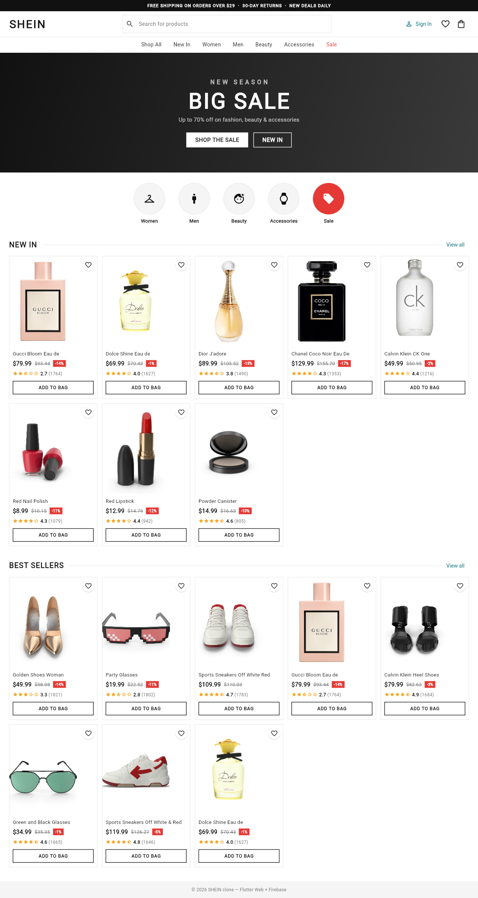
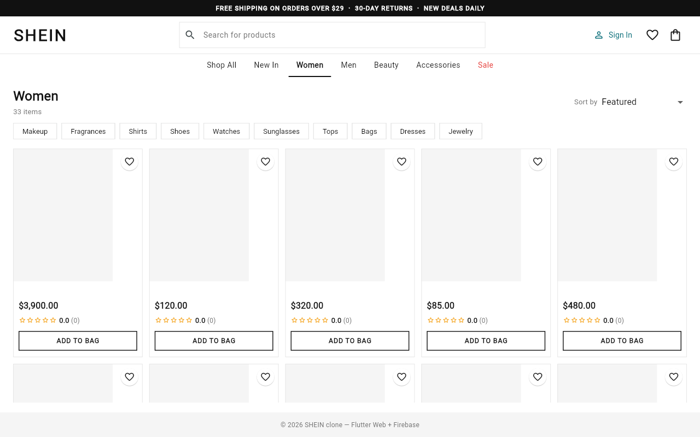
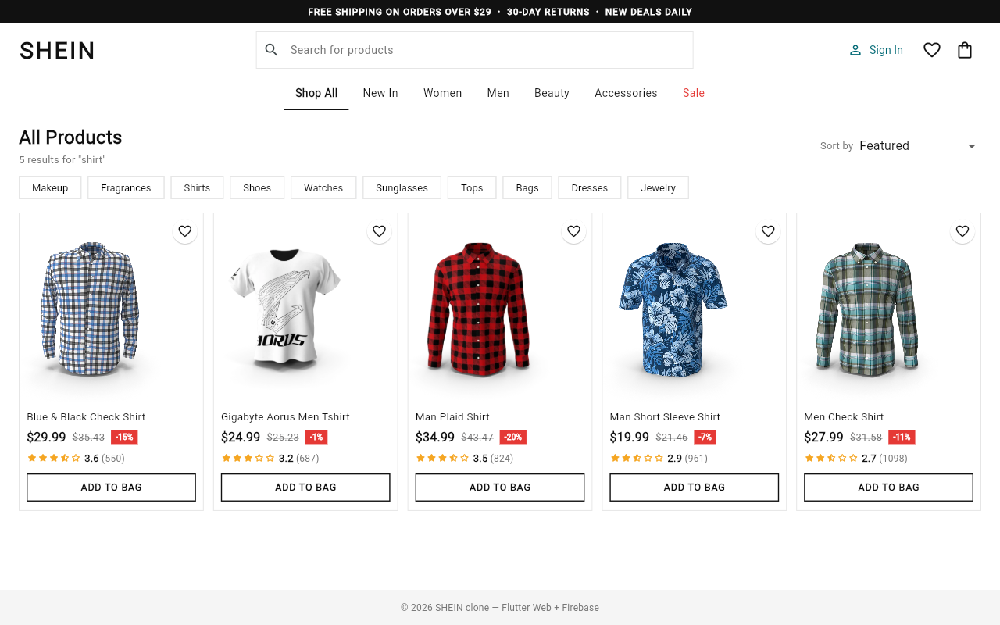
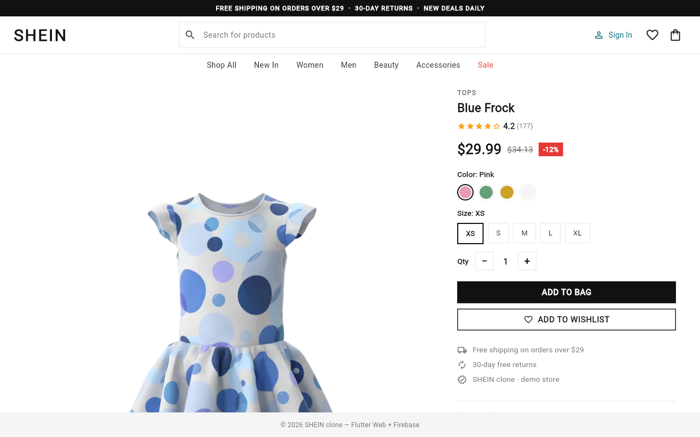
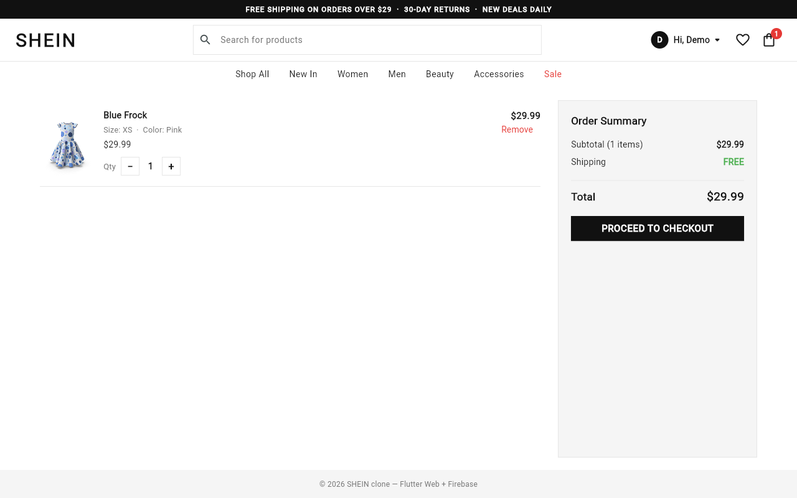
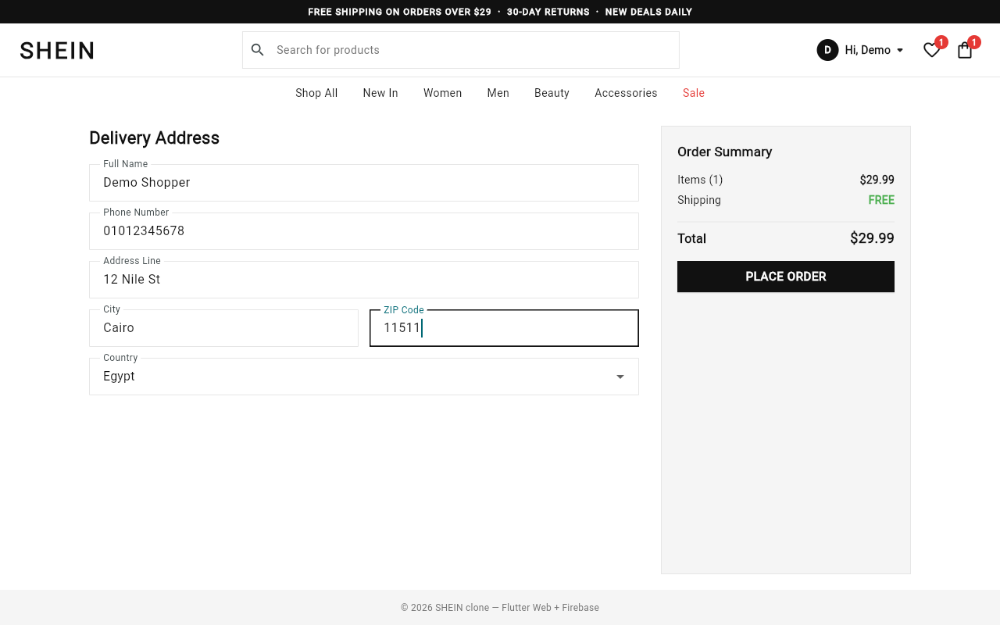
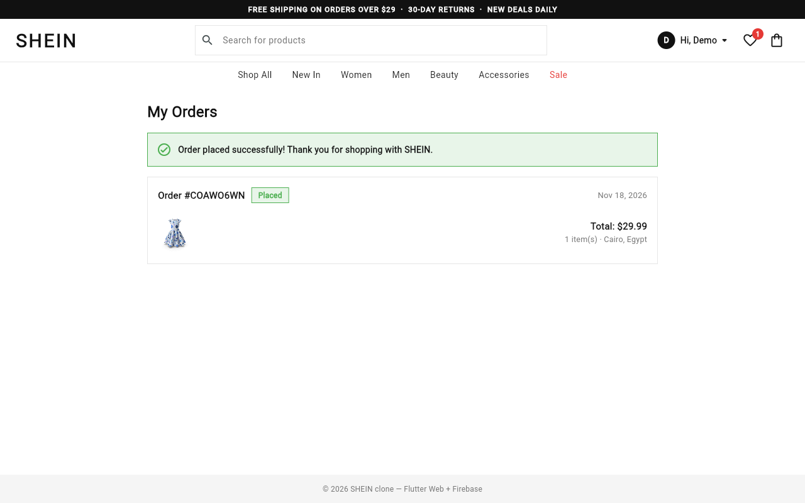
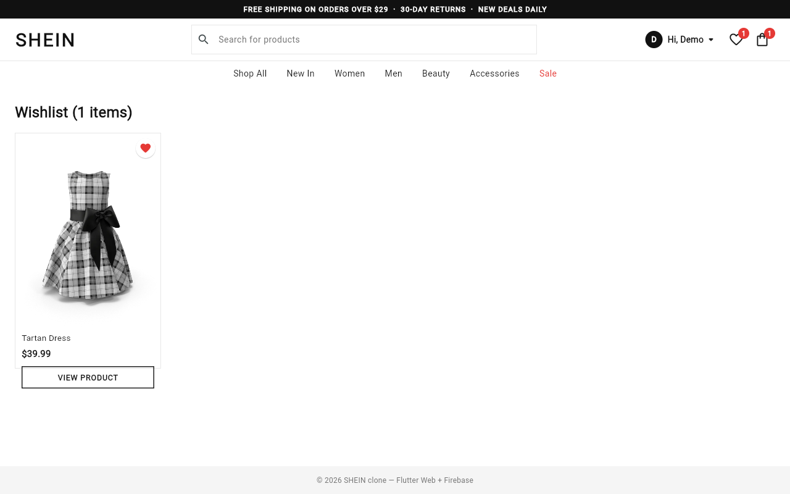
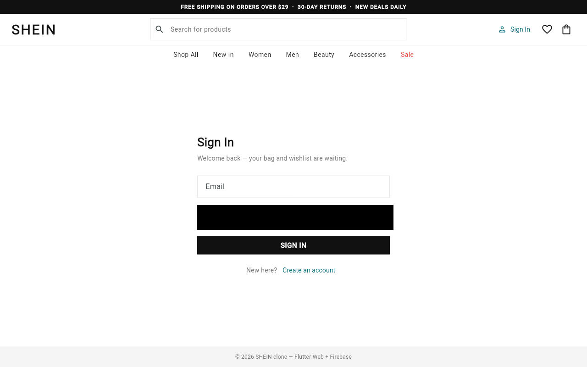

# SHEIN Clone — Flutter Web E-Commerce App

A fully functional, SHEIN-style online store running on **Flutter Web** with
**Firebase** as its backend. A visitor can browse a 52-product catalog, search
and filter it, sign up with email and password, manage a persistent cart and
wishlist, and place real orders — every step stored in Cloud Firestore and
working end to end.

**Stack:** Flutter (Web) · `flutter_bloc` (MVVM, Cubit per feature) ·
Firebase Auth · Cloud Firestore · go_router

|  |
| :---: |
| **Home** — hero banner, category strip, and New In / Best Sellers / Sale sections, all driven by Firestore |

|    |
| :---: |
| **Catalog** (groups + category filters) · **Search** (`?q=shirt`) · **Product details** (colors, sizes, quantity) |

|    |
| :---: |
| **Cart** (Firestore-backed, realtime badge) · **Checkout** (address + summary) · **My Orders** (confirmation banner, order history) |

|   |
| :---: |
| **Wishlist** · **Sign in** (email/password, mapped friendly errors) |

## What it does

| Area | What works |
| --- | --- |
| Home | Hero banner, category strip, New In / Best Sellers / Sale sections (all Firestore-driven) |
| Catalog | Group pages (`/catalog/women`), search (`/catalog/all?q=shirt`), category-chip filters, empty states |
| Product | Image carousel, price/discount/rating, size & color pickers, quantity stepper |
| Cart | Firestore-backed per-user cart, realtime badge, quantity updates, remove, order summary |
| Wishlist | Firestore-backed per-user wishlist, save/remove from product pages, wishlist page |
| Auth | Email/password sign-up & sign-in, session persistence across reloads, friendly mapped errors |
| Checkout | Delivery-address form, order written to Firestore, cart cleared, redirect to My Orders with a success banner |
| Orders | Per-user order history (`/orders?placed=1` shows the confirmation banner) |
| Guest mode | Everything is browsable without an account; account-only actions open a sign-in prompt |

## Engineering highlights

- **Feature-first MVVM** — one Cubit (ViewModel) per feature, screens hold
  widgets only, all Firebase access behind repository interfaces
  (`lib/features/<feature>/viewmodel` + `lib/data/repositories`).
- **Realtime by design** — cart, wishlist and orders stream from Firestore, so
  badges and lists stay in sync without manual refresh.
- **Security rules that match the data model** — carts, wishlists and profiles
  are strictly uid-matched (`request.auth.uid == uid`); orders are created by
  and visible only to their buyer; the catalog is publicly readable and its
  seeded documents are immutable (`create`-only).
- **Verified behavior, not just compiled code** — clean `flutter analyze`,
  20 unit tests (widgets, catalog logic, error mapping), and the full user
  journey verified end to end in headless Chromium against the real Firebase
  backend, driving the app through its accessibility tree.
- **Accessible UI** — the semantics tree is always exposed, which makes the
  store usable with screen readers and drivable by automated tests.
- **Clean error surfacing** — every Firebase exception maps to a short,
  human-readable message (`FirebaseErrorMapper`).

## Architecture

**Feature-first MVVM** with `flutter_bloc` (one Cubit per feature):

```
lib/
├── main.dart                  # Firebase init, path-URL strategy, semantics, Bloc observer
├── app.dart                   # MaterialApp + theme + router
├── core/
│   ├── router/app_router.dart # go_router route table (below)
│   ├── theme/                 # AppColors / AppTheme
│   ├── utils/                 # auth_gate (guest prompt), FirebaseErrorMapper, Fmt, BlocObserver
│   └── widgets/               # shared UI: ProductCard, PriceText, RatingStars, page states…
├── data/
│   ├── models/                # ProductModel, CartItemModel, OrderModel (Firestore maps ⇄ objects)
│   ├── repositories/          # auth / product / cart / wishlist / order repositories
│   └── seeding/product_seed.dart  # 52 demo products (generated from dummyjson.com demo data)
└── features/<feature>/
    ├── view/                  # screens (Flutter widgets only)
    └── viewmodel/             # Cubit + state per feature
```

**Data flow:** Screen → Cubit (ViewModel) → Repository → Firebase.
Cubits self-subscribe to `authStateChanges`, so cart/wishlist/orders switch
user context automatically on sign-in/out.

**Firestore layout:**

| Path | Contents |
| --- | --- |
| `products/{id}` | catalog, seeded on first run (`ensureSeeded()` writes 52 docs if empty) |
| `carts/{uid}/items/{productId__size}` | per-user cart lines (transaction-based add) |
| `wishlists/{uid}/items/{productId}` | per-user wishlist |
| `orders/{id}` | per-user orders (uid-filtered, newest first) |
| `users/{uid}` | profile (name, email, createdAt) |

**Routes** (path-URL strategy — real URLs, no `#`):

`/` · `/login` · `/signup` · `/catalog/<group>?q=` · `/product/<id>` ·
`/cart` · `/wishlist` · `/checkout` · `/orders?placed=1`

## Verification guide

### Prerequisites

- Flutter SDK `^3.13.4` (web enabled)
- A Firebase project wired via `flutterfire configure`
  (`lib/firebase_options.dart` is generated and already committed for this task)

### 1. Static analysis + unit tests

```bash
flutter analyze   # No issues found
flutter test      # 20 tests: ProductCard/PriceText/RatingStars widgets,
                  # catalog group+filter logic, Firebase error mapping
```

### 2. Build

```bash
flutter build web   # → build/web
```

### 3. End-to-end verification

The full user flows (guest browsing → sign-up → cart → wishlist → checkout
→ orders) were verified end to end in headless Chromium against the real
Firebase backend, driving the built app through its accessibility tree.
The E2E toolchain and suites live outside this repository and are not
distributed with it.

### 4. Manual run

```bash
flutter run -d chrome     # dev — or serve build/web with any static server
```

First run seeds the catalog (52 products) into Firestore automatically.

## Security notes

- `firestore.rules` restrict per-user data to its owner and keep the demo
  catalog immutable after seeding. Deploy them with
  `firebase deploy --only firestore:rules`.
- The open anonymous `create` on `products` exists solely for first-run demo
  seeding; remove it (and seed through a script) before any real deployment.
- `.zcode/` is local tooling config and is never committed.
